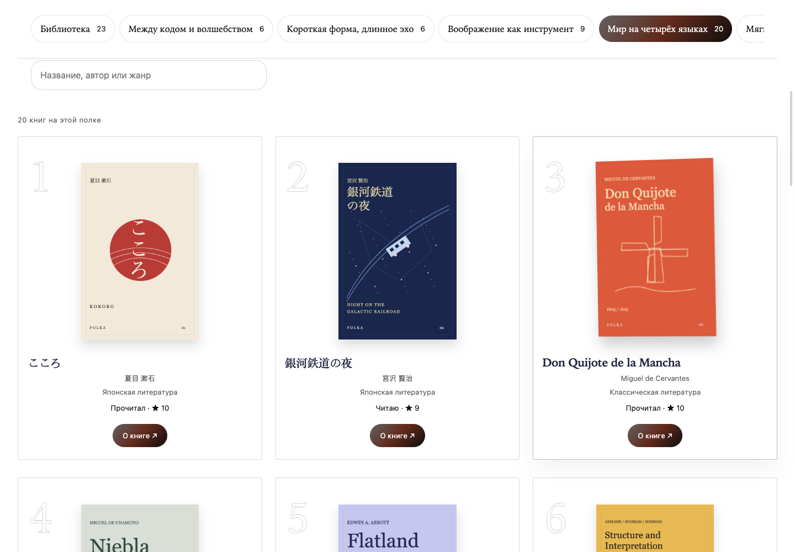
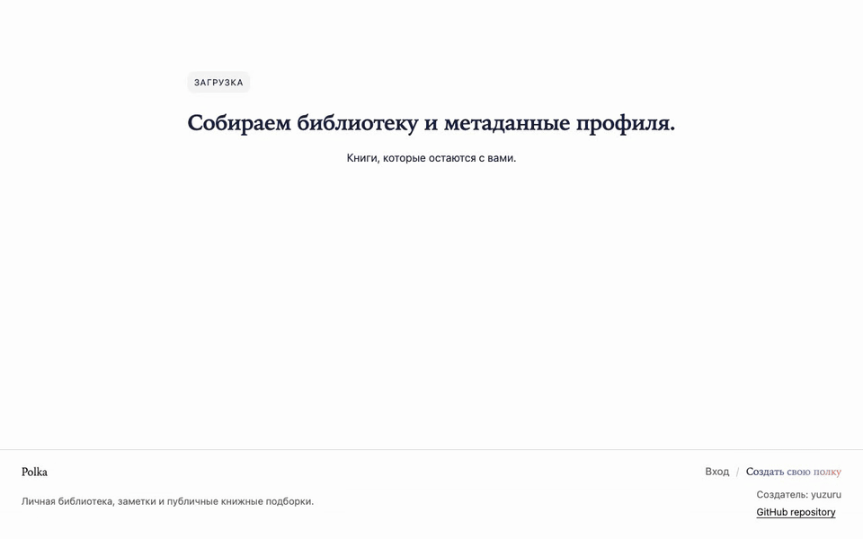

# Polka

<p align="center"></p>

Личная библиотека с публичной полкой, подборками, цитатами и читательскими заметками. Выразительная книжная типографика, обложки с собственной палитрой и спокойная анимация помогают исследовать коллекцию.





## Возможности

- Регистрация, вход и сессия; отдельные режимы владельца и гостя.
- Книги с обложками, статусами, оценками, цитатами и мнениями; создание, редактирование, удаление и управление публичностью.
- Поиск, фильтры, сортировка, перестановка книг и тематические подборки.
- JSON-импорт с атомарным сохранением и ZIP-экспорт полки с обложками.
- Черновики текста отдельно для каждого аккаунта; keyboard/touch-навигация и reduced motion.
- Демо-профиль `yuzuru`: 24 книги, 20 оригинальных обложек, четыре мнения у каждой многоязычной книги и шесть публичных подборок. Классика, Борхес, Дадзай, SICP, Кнут и Стругацкие на четырёх языках. [Книги и источники](docs/demo-content.md).

## Стек

Angular 21 · TypeScript · Taiga UI 4 · NgRx Signal Store · Go 1.27+ · PostgreSQL 17 · S3-compatible storage · Docker Compose · GitHub Actions / GHCR / Kubernetes.

## Локальный запуск

Нужны Docker Compose с Buildx и Node.js 22 для инструментов. Ставьте npm-зависимости из корня: один workspace и один lockfile.

```bash
npm ci
POSTGRES_PORT=55432 BACKEND_PORT=18081 FRONTEND_PORT=14200 \
STORAGE_PORT=19000 STORAGE_CONSOLE_PORT=19001 docker compose up -d --build
POLKA_DEMO_URL=http://127.0.0.1:14200 npm run demo:seed
```

Откройте [локальную полку](http://127.0.0.1:14200/yuzuru). Демо-вход: `reader@polka.local` / `Reader1234`. Известная учётка создаётся только при `APP_ENV=development`.

Порты можно переопределять. Без переменных Compose использует frontend 4200, API 8080, PostgreSQL 5432, MinIO 9000/9001. Данные живут в именованных volumes и сохраняются при обычном перезапуске.

MinIO собирается из [официальных исходников](https://github.com/minio/minio) с фиксированным commit и проверкой SHA-256. Первый запуск скачивает исходники и зависимости. Для локального уже сохранённого совместимого образа можно задать `MINIO_IMAGE` и выполнить `docker compose up -d --no-build` после сборки остальных сервисов. Архивированный upstream требует отдельного решения по дальнейшему сопровождению хранилища.

### Разработка с HMR

После запуска backend/PostgreSQL/MinIO можно заменить контейнер frontend сервером Angular:

```bash
BACKEND_PORT=18081 npm run start:frontend -- --port 14201
```

API автоматически проксируется на `BACKEND_PORT` (по умолчанию 8080), а дополнительные аргументы передаются Angular CLI. Для native backend требуется Go 1.27+ и `DATABASE_URL`; запуск — `npm run start:backend`.

## Проверки

```bash
npm run lint
npm run format:check
npm run test:frontend
npm run test:backend
go -C backend vet ./...
npm run audit:backend
npm run build:frontend
npm run compose:check
npm run playwright:install
npm run test:component
```

Playwright по умолчанию собирает и запускает Compose. Для уже работающего стека, включая HMR, используйте:

```bash
POLKA_REUSE_STACK=1 FRONTEND_PORT=14200 BACKEND_PORT=18081 npm run test:component
```

Проверки больше не останавливают существующий стек. PostgreSQL integration tests включаются через `POLKA_TEST_DATABASE_URL`, указывающую на отдельную тестовую БД: тесты создают временную схему и удаляют только её. Без этой переменной DB-тест явно пропускается; unit-тесты не подтверждают транзакции и SQL-видимость.

На macOS при недоступном Playwright CDN можно использовать установленный Chrome:

```bash
PLAYWRIGHT_CHROMIUM_EXECUTABLE_PATH='/Applications/Google Chrome.app/Contents/MacOS/Google Chrome' \
POLKA_REUSE_STACK=1 FRONTEND_PORT=14200 BACKEND_PORT=18081 npm run test:component
```

## Визуальная демонстрация

`npm run demo:covers` пересобирает локальные обложки. `npm run demo:capture` снимает десктоп, мобильную версию, WebM и GIF реального поведения; для записи нужен `npx playwright install ffmpeg`, для GIF — системный `ffmpeg`.

[Десктопная страница книги](docs/screenshots/book-desktop.png) · [Мобильная полка](docs/screenshots/profile-mobile.png) · [Мнения внутри книги](docs/screenshots/book-opinions-desktop.png) · [Мобильная книга](docs/screenshots/book-mobile.png) · [Видео](docs/screenshots/polka-interactions.webm).

## Документация

- [Текущая фаза и следующие шаги](docs/roadmap.md)
- [Результаты аудита и проверки](docs/audit-2026-10-11.md)
- [UX и интерфейс](docs/ux.md)
- [Демо-контент и источники](docs/demo-content.md)
- [Развёртывание](docs/deploy.md)

Production URL: [polka.keykomi.com](https://polka.keykomi.com). Исторические deployment-отчёты не подтверждают текущее состояние production; эта итерация запускается и проверяется локально.
